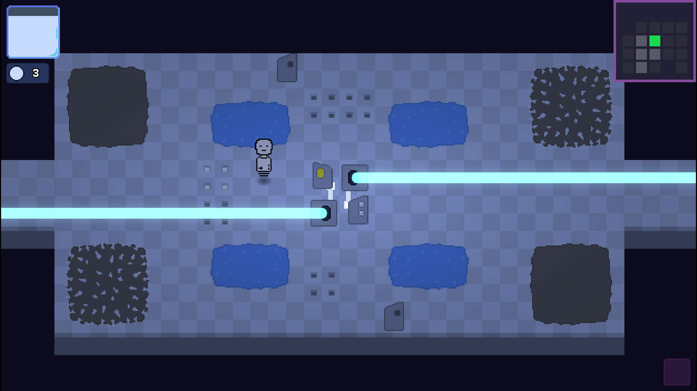

# RE:RUN

 

2D піксельна пригодницька гра з головоломками та псевдоізометричною проєкцією, розроблена на рушії **Godot 4**. Гравець досліджує відкриті платформи, використовує телекінез та взаємодіє з оточенням, комбінуючи багаторівневі логічні схеми, лазерні промені, дзеркала, колони й мости для просування поверхом.

---

## Основні механіки

- **Лазерні та логічні головоломки:** система лазерних емітерів, дзеркал (відбиття та розділення променя), натискних плит, інтерактивних колон (під руни та монети) і багаторівневих логічних дротів (`ConnectorsTilemap`) із підтримкою логіки `AND`, що керують мостами та емітерами.
- **Телекінез та взаємодія:** переміщення об'єктів на відстані, підбір і використання предметів через інвентарний слот (`InteractArea`).
- **Дослідження світу:** процедурна генерація поверхів `9×9` (зовнішнє кільце, внутрішнє кільце та серцевина), вороги, пастки, кристалічні глиби з ефектом сповільнення та HUD із мінікартою (`5×5`) і повною картою (`M` / `Tab`).

---

## Документація проєкту

- [Mindmap проєкту](./docs/Mindmap.pdf)
- [Блок-схема](./docs/Блок%20схема.pdf)
- [Діаграма станів](./docs/Діаграма%20станів.pdf)
- [Ескізи та візуальні концепти](./docs/Ескізи.pdf)
- [Порівняльна таблиця](./docs/Порівняльна%20таблиця.pdf)
- [Презентація проєкту](./docs/Презентація%20проєкту.pptx)
- [Псевдокод основної логіки](./docs/Псевдо-код.pdf)

---

## Історія версій

### v0.2.6 — Меню гри, система душ та основа діалогів
- **Головне меню та меню паузи:** додано стартовий екран із навігацією з клавіатури, приховуванням курсора миші при запуску та внутрішньоігрове меню паузи.
- **Система душ, ролей та зв'язок:** впроваджено випадковий спавн душ на локаціях з об'єднанням у групи, розподілом ролей (*Зрадник*, *Захисник*, *Суперник*, *Жертва*) та автоматичним формуванням зв'язків друзів і ворогів усередині групи.
- **Діалогова система (WIP):** закладено архітектуру діалогів у стилі *Undertale* із підтримкою ефекту друкування тексту, вибору варіантів відповіді, розгалужень залежно від ролі душі та динамічної підстановки імен учасників зв'язки.

### v0.2.5 — Псевдоізометрія, архітектура платформ та оновлена логіка
- **Візуальний редизайн та псевдоізометрія:** повністю оновлено стиль гри та впроваджено псевдоізометричну проєкцію під 60%.
- **Архітектура відкритих платформ:** прибрано класичні стіни - основою локацій стали платформи, з'єднані логічними мостами, та інтерактивні колони (під руни й монети).
- **Структура поверху (9×9):** генератор рівнів будує поверх із трьох зон - зовнішнього кола, внутрішнього кола та центральної серцевини.
- **Розширена логіка проводів:** додано підтримку кількох шарів конекторів, живлення виключно через сокети та логіку `AND` для приймачів.
- **Оновлена система карти:** стандартна мінікарта в HUD відображає область розміром до `5×5` комірок, а клавіші `M` або `Tab` відкривають повну карту поверху `9×9`.
- **Рефакторинг коду:** оптимізовано взаємодію з інтерактивними тайлами, механіку сповільнення на активованих кристалах.

### v0.2 — Модульна архітектура та лазерні головоломки
- **Архітектура проєкту:** реорганізовано структуру папок та модулів гри.
- **Лазерні та логічні головоломки:** додано лазерні емітери, дзеркала (відбиття та розділення), логічні дроти, натискні плити та динамічну активацію стін.
- **Телекінез та інвентар:** реалізовано переміщення об'єктів на відстані, систему взаємодії з оточенням, підбір предметів та інвентарний слот.
- **Двері та пастки:** додано кристалічні двері, двері з шипами та повноцінно робочі підлогові пастки.
- **Розширений HUD:** додано мінікарту, лічильник монет, слот предмета та підказки взаємодії.
- **Баланс бойової системи:** прибрано атакувальний міні-лазер гравця на користь взаємодії з оточенням і головоломками.

### v0.1 — Базовий прототип
- **Базовий геймплей:** реалізовано переміщення персонажа та початкову рандомну генерацію кімнат із шаблонів.
- **Оточення:** додано базові тайли стін і блоків (без дверей та логічних елементів).
- **Вороги та атака:** додано базових ворогів із ближньою атакою та атакувальний міні-лазер гравця.
- **Початковий HUD:** створено інтерфейс з індикатором здоров'я.